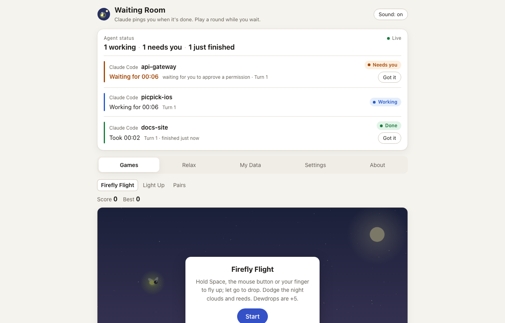
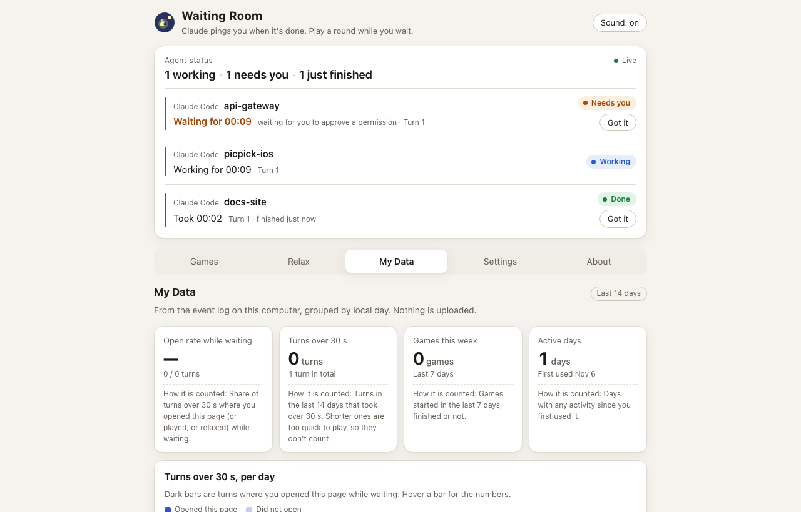
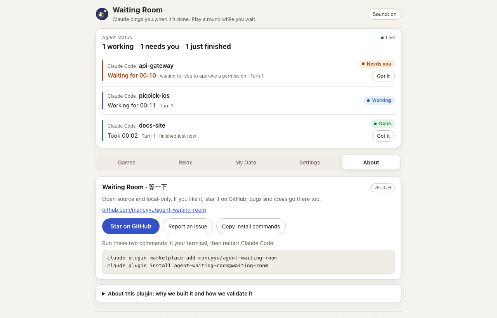
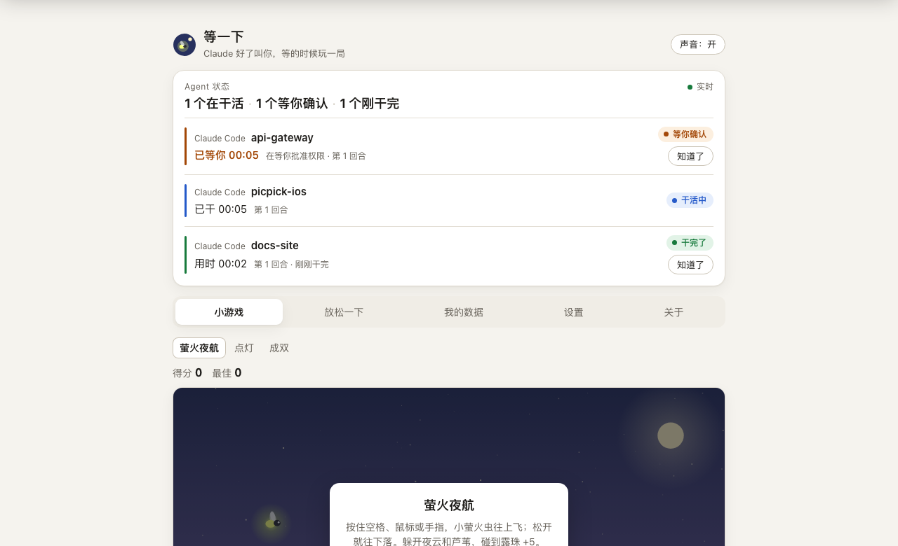

# Waiting Room (等一下)

**Claude pings you when it's done. Play a round while you wait.**

A Claude Code plugin that watches your coding agents for you. When Claude finishes, fails, or stops to ask for permission, you get a macOS notification and a banner in your browser. While it works, you get a local web page with a status board for every session, three 30-second games, a one-minute breathing exercise, and a page of local stats that tells you whether any of this is actually useful.

Everything stays on your machine. It never reads your prompts or replies, never proxies a request, and has no ads.

[中文说明](README.zh-CN.md) · [Changelog](CHANGELOG.md) · [Report an issue](https://github.com/mancyyu/agent-waiting-room/issues)



<details>
<summary>More screenshots: My Data, About, and the Chinese UI</summary>







</details>

## How it works

1. You submit a task in Claude Code. A hook records "working".
2. If the task runs longer than 20 seconds, the waiting room opens in your browser (at most once every 5 minutes, so a burst of short tasks doesn't keep popping it up).
3. When Claude is done, fails, or stops to wait for your approval or answer, the page shows a banner, any running game pauses, and a system notification fires.
4. Click **Back to terminal** and carry on.

## Install

Requires Node.js (any recent version). If Node is missing, the hooks exit quietly and never block Claude Code.

One step, inside Claude Code 2.1.275 or later:

```
/plugin install agent-waiting-room --marketplace mancyyu/agent-waiting-room
```

Or two steps from a terminal:

```bash
claude plugin marketplace add mancyyu/agent-waiting-room
```

```bash
claude plugin install agent-waiting-room@waiting-room
```

Restart Claude Code once after installing.

**Upgrade**

```bash
claude plugin marketplace update waiting-room
```

```bash
claude plugin update agent-waiting-room@waiting-room
```

**Uninstall**

```bash
claude plugin uninstall agent-waiting-room@waiting-room
```

To remove local data as well: `rm -rf ~/.claude/waiting-room`. To remove the marketplace: `claude plugin marketplace remove waiting-room`.

## Use

| You want to | Type in Claude Code |
|---|---|
| Open the waiting room now | `/agent-waiting-room:open` |
| See current settings | `/agent-waiting-room:config` |
| Reminders only, no games | `/agent-waiting-room:config remind only` |
| Bring the games back | `/agent-waiting-room:config mode=both` |
| Stop auto-opening the page | `/agent-waiting-room:config autoOpen=false` |
| Wait longer before auto-open | `/agent-waiting-room:config delay 40 seconds` |
| Turn off system notifications | `/agent-waiting-room:config notify=false` |
| Quiet hours | `/agent-waiting-room:config quiet hours 23:00-08:00` (`quietHours=off` to clear) |
| Switch language | `/agent-waiting-room:config lang=en` / `lang=zh` / `lang=auto` |
| Turn off local stats | `/agent-waiting-room:config metrics=off` |
| Open phone access | `/agent-waiting-room:config lan=true` (`lan=off` to close, `lanToken=reset` for a new link) |

The same settings are on the page's **Settings** tab. The file is `~/.claude/waiting-room/config.json`:

| Key | Default | Meaning |
|---|---|---|
| `mode` | `both` | `both` = reminders + games; `remind` = reminders only: no auto-open, notifications only, Games and Relax tabs hidden |
| `autoOpen` | `true` | Open the page when a turn is still running after `delaySeconds` |
| `delaySeconds` | `20` | Seconds to wait before auto-opening (0–3600) |
| `notify` | `true` | System notification on done / failed / needs input |
| `quietHours` | `null` | e.g. `23:00-08:00`, may cross midnight; no auto-open and no notifications inside it |
| `lang` | `auto` | `auto` follows your browser and OS; `zh` or `en` to force |
| `metrics` | `true` | Record a local event log for the My Data tab |
| `lan` | `false` | Phone access on the same Wi-Fi |
| `lanToken` | generated on first `lan=true` | Access token for the phone link, stored only on this machine |
| `port` | `47823` | Local port; change only if it's taken |

## What's on the page

- **Status** — one card per session: agent, project, state (Working / Needs you / Done / Failed), time on this turn, turn count, last turn's duration. Sessions that need you sort first. Anything silent for 10 minutes is marked *Probably ended*. Sessions that finished before you opened the page show *Just finished* on the card instead of a banner.
- **Banners** — appear the moment a state changes, the tab title blinks, and a short chime plays (browsers require one click on the page first).
- **Games** — Firefly Flight (hold to fly), Light Up (3×3 reaction grid), Pairs (memory). All original, each round under a minute, all pause when a banner appears.
- **Relax** — Box Breathing (about a minute), a 20-20-20 eye break, four stretches.
- **My Data** — open rate while waiting (of turns over 30 seconds, how often you opened the page), turns over 30 s, games played, active days, a 14-day sparkline, a waiting-time histogram, and the targets from the original feasibility study. You can export an anonymised summary that contains no project names or session IDs.
- **Settings** — the switches above, plus a page that spells out what is and isn't stored.
- **About** — version, GitHub link, install commands.

In *remind only* mode the Games and Relax tabs disappear; the page is just Status, My Data and Settings.

## Phone access (optional, off by default)

1. `/agent-waiting-room:config lan=true`
2. Open the waiting room on your computer; the **Settings** tab shows a phone URL that carries the token.
3. Open that URL on a phone on the same Wi-Fi.

Only turn this on inside a network you trust. `lanToken=reset` invalidates the old link immediately; `lan=off` closes access. With the macOS firewall on, you may be asked once whether `node` may accept incoming connections — allow it. LAN access supports IPv4 addresses only, not `.local` hostnames.

## Privacy: what is stored, what isn't

Everything lives in `~/.claude/waiting-room/`:

- per-session ID, project folder name, state, timestamps, turn count and durations;
- an event log (`events/`): event type, time, session ID, and numbers such as durations, scores and modes — kept for 30 days;
- your settings.

Not stored: prompts, replies, command text, error text. Nothing is uploaded. The local page listens on 127.0.0.1 only; with phone access on it also listens on the LAN, and every request must carry the token. Write endpoints accept requests from the page itself only.

The plugin does not proxy or forward model requests, does not touch your credentials, does not modify Claude Code's own UI, and contains no ads.

## Other agents

Codex CLI and Cursor hooks can call the same script; see [docs/adapters.md](agent-waiting-room/docs/adapters.md). **This has not been run inside a real Codex or Cursor install.** Cursor has no "waiting for approval" event, so its sessions never show *Needs you*.

## Known limits

- System notifications are macOS only. On Windows and Linux everything else works; there is just no notification.
- Short tasks also notify. If that's too chatty, switch to *remind only*, set quiet hours, or raise the delay.
- With the page in a background tab, a banner can arrive a few seconds to a minute late — browsers throttle background pages.
- In the desktop app, a long session sometimes never receives its end event and stays *Working*; it's marked *Probably ended* after 10 minutes and cleaned up after 2 hours.
- The project name is the name of the directory your terminal was in when you submitted the task.
- Events are kept for 30 days, so "first use" and retention numbers shift after that.

## Development

```bash
node agent-waiting-room/tests/run-tests.js
```

Node built-ins only, about 30 seconds, writes to a temp dir, never touches `~/.claude/waiting-room`, never opens a browser or sends a notification. Official validation: `claude plugin validate ./agent-waiting-room` and `claude plugin validate .` from the repo root.

```
.claude-plugin/marketplace.json  the marketplace (this repo)
agent-waiting-room/
  .claude-plugin/plugin.json     plugin manifest
  hooks/hooks.json               7 hooks: submit, stop, failure, notification, pre/post tool, session end
  bin/waiting-room               entry point: finds Node, runs cli.js
  scripts/cli.js                 hook handling and CLI
  scripts/server.js              local server
  scripts/lib.js                 config, sessions, notifications, browser launch
  scripts/events.js              event log and stats
  scripts/strings.js             zh / en strings
  scripts/web.js                 Host / token / CSRF checks, page shell
  public/hub.html                the page (single file)
  skills/open  skills/config     the two slash commands
  tests/run-tests.js             automated tests
  docs/                          specs, adapters, change notes
```

## License

MIT © 2026 mancy
