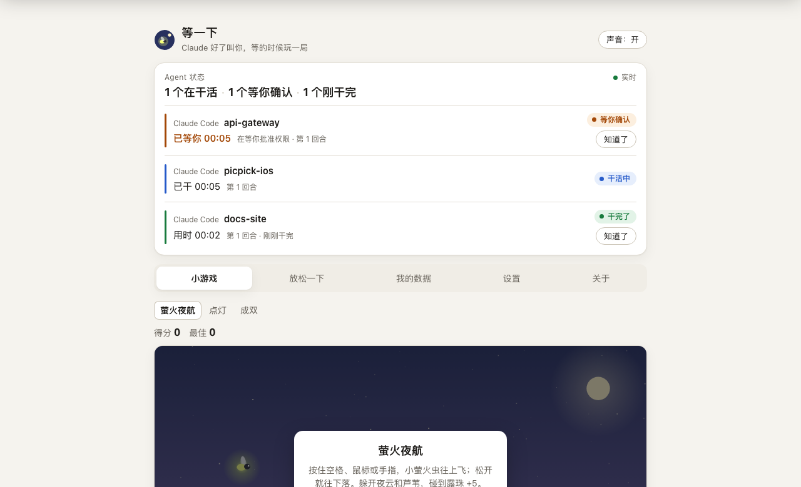
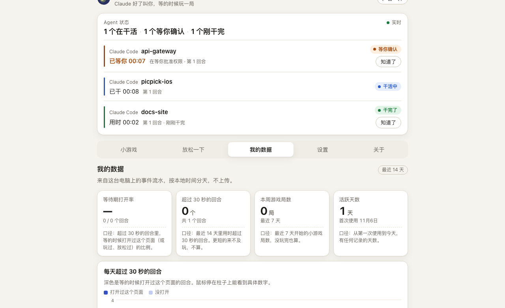
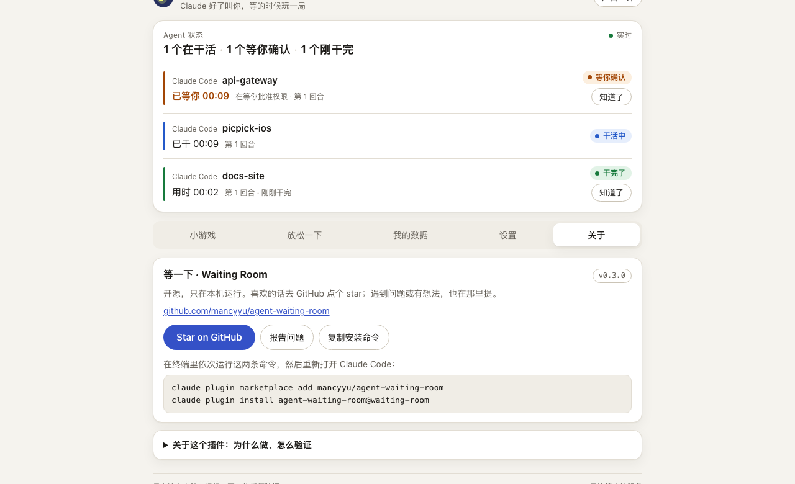
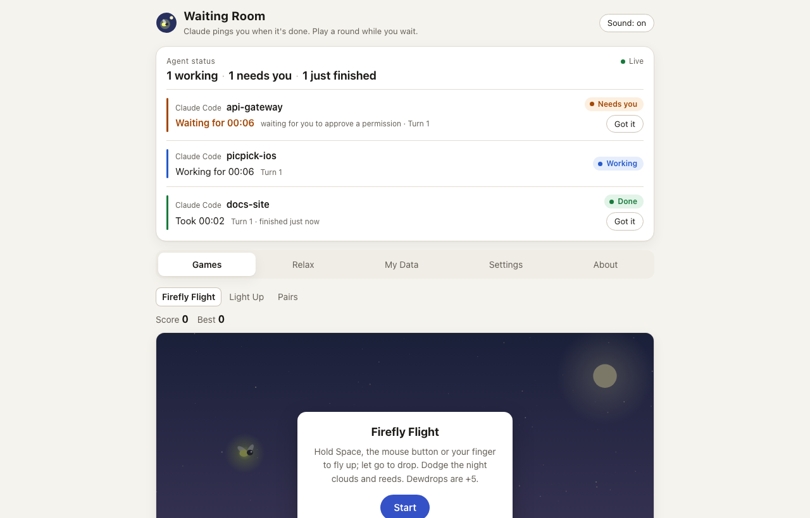

# 等一下 · Waiting Room

**Claude 好了叫你，等的时候玩一局。**

这是一个 Claude Code 插件。它帮你盯着正在干活的 agent：干完了、出错了、或者停下来等你确认时，弹系统通知叫你回去。等待的时候，它给你一个本地网页，里面有一眼看清所有会话状态的面板、三个 30 秒能玩完的小游戏、一分钟的放松练习，还有一页本机统计，用来验证这个东西到底有没有用。

所有数据只存在你这台电脑上。它不读提示词，不读回复，不转发任何请求，没有广告。

[English](README.md) · [更新记录](CHANGELOG.md) · [报告问题](https://github.com/mancyyu/agent-waiting-room/issues)



<details>
<summary>更多截图：我的数据、关于页、英文界面</summary>







</details>

## 它怎么工作

1. 你在 Claude Code 里提交任务，钩子记下「工作中」。
2. 任务超过 20 秒还没结束，浏览器自动打开等候室（5 分钟内只打开一次，免得连着提交几个任务时反复弹）。
3. Claude 干完、出错，或者停下来等你批准、等你回答时，等候室顶部弹出横幅，正在玩的游戏自动暂停，同时发一条系统通知。
4. 你点「回去看看」，回到终端继续。

## 安装、升级、卸载

需要 Node.js（任意近几年的版本）。没有 Node 时，钩子会安静地跳过，不会打断 Claude Code。

**安装**

Claude Code 2.1.275 或更新的版本，在对话里输入一行就行：

```
/plugin install agent-waiting-room --marketplace mancyyu/agent-waiting-room
```

或者在终端里分两步：

```bash
claude plugin marketplace add mancyyu/agent-waiting-room
```

```bash
claude plugin install agent-waiting-room@waiting-room
```

装完重启一次 Claude Code。

**升级**

```bash
claude plugin marketplace update waiting-room
```

```bash
claude plugin update agent-waiting-room@waiting-room
```

**从本地测试版（`waiting-room-local`）迁过来的人**：先 `claude plugin uninstall agent-waiting-room@waiting-room-local`，再 `claude plugin marketplace remove waiting-room-local`，然后按上面的「安装」两步走。`~/.claude/waiting-room` 里的设置和数据会保留。

**卸载**

```bash
claude plugin uninstall agent-waiting-room@waiting-room
```

要连本机数据一起删，再运行 `rm -rf ~/.claude/waiting-room`；要删掉插件市场，运行 `claude plugin marketplace remove waiting-room`。

## 打开等候室和改设置

| 你想做什么 | 在 Claude Code 里输入 |
|---|---|
| 现在就打开等候室 | `/agent-waiting-room:open` |
| 查看当前设置 | `/agent-waiting-room:config` |
| 只要提醒、不要游戏 | `/agent-waiting-room:config 只要提醒` |
| 恢复提醒 + 小游戏 | `/agent-waiting-room:config mode=both` |
| 关闭自动打开 | `/agent-waiting-room:config 关闭自动打开` |
| 自动打开前多等一会儿 | `/agent-waiting-room:config 延迟 40 秒` |
| 关闭系统通知 | `/agent-waiting-room:config 关闭通知` |
| 短任务不要通知 | `/agent-waiting-room:config 最短通知秒数=30`（`notifyMinSeconds=0` 则每个回合都通知） |
| 设置勿扰时段 | `/agent-waiting-room:config 勿扰 23:00-08:00`（`quietHours=off` 取消） |
| 切换语言 | `/agent-waiting-room:config 语言 中文` / `lang=en` / `lang=auto` |
| 关闭本机统计 | `/agent-waiting-room:config metrics=off` |
| 打开手机访问 | `/agent-waiting-room:config 打开手机访问`（`lan=off` 关闭，`lanToken=reset` 换新链接） |

同样的设置也可以在等候室的「设置」页里改。设置文件在 `~/.claude/waiting-room/config.json`：

| 键 | 默认 | 含义 |
|---|---|---|
| `mode` | `both` | `both` = 提醒 + 小游戏；`remind` = 只要提醒：不自动打开网页，只发通知，网页里也不显示游戏 |
| `autoOpen` | `true` | 回合超过 `delaySeconds` 仍在工作时自动打开等候室 |
| `delaySeconds` | `20` | 自动打开前等待的秒数（0–3600） |
| `notify` | `true` | 干完、出错、等你确认时发系统通知 |
| `notifyMinSeconds` | `10` | 回合不足这么多秒就不发「干完了」的通知（0–3600）；等你确认和出错照常通知 |
| `quietHours` | `null` | 勿扰时段，如 `23:00-08:00`，可跨午夜；期间不自动打开、不发通知 |
| `lang` | `auto` | `auto` 跟随浏览器和系统语言；`zh` 或 `en` 固定一种 |
| `metrics` | `true` | 是否在本机记录事件流水，供「我的数据」页统计 |
| `lan` | `false` | 手机访问开关 |
| `lanToken` | 首次开启 `lan` 时生成 | 手机访问令牌，只存本机 |
| `port` | `47823` | 本地端口，只在被占用时才需要改 |

## 等候室里有什么

- **状态面板**：每个会话一张卡，显示 agent 名、项目名、状态（干活中 / 等你确认 / 干完了 / 出错了）、本回合已用时、累计第几个回合、上一回合用时。等你确认的排最前。超过 10 分钟没动静的会话标成「可能已结束」。打开页面之前就已经干完的会话只在卡片上显示「刚干完」，不再弹横幅。
- **提醒横幅**：状态一变就弹出，标签页标题跟着闪，有一声短提示音（浏览器要求先点过页面才会响）。
- **小游戏**：萤火夜航（按住上飞）、点灯（九宫格反应）、成双（翻牌配对）。都是原创，每局几十秒，横幅一出现就自动暂停。
- **放松一下**：方块呼吸（约 1 分钟）、护眼 20-20-20、四个伸展动作。
- **我的数据**：等待期打开率（超过 30 秒的回合里，有多少次你打开了等候室）、超过 30 秒的回合数、游戏局数、活跃天数；14 天的小图；等待时长四档分布；和调研里的验证门槛对照。可以导出一份不含项目名和会话 ID 的匿名汇总。
- **设置**：上面那些开关，加一页「存了什么、没存什么」。
- **关于**：版本号、GitHub 链接、一键复制安装命令。

「只要提醒」模式下，小游戏和放松两个标签会隐藏，等候室只剩状态面板、我的数据和设置。

## 手机访问（可选，默认关闭）

1. 输入 `/agent-waiting-room:config 打开手机访问`。
2. 在电脑上打开等候室，到「设置」页找到手机网址，网址里带着令牌。
3. 手机连同一个 Wi-Fi，打开这个网址。

只在可信的家庭或公司网络里开。担心链接外泄时运行 `lanToken=reset`，旧链接马上失效；用完后 `lan=off` 关掉。macOS 防火墙开着时，第一次可能会问「是否允许 node 接受传入连接」，要选允许。局域网访问只支持 IPv4 地址，不支持 `xxx.local` 这类主机名。

## 隐私：存了什么，没存什么

存在 `~/.claude/waiting-room/` 里的只有：

- 每个会话的 ID、项目文件夹名、状态、时间戳、回合数和用时；
- 事件流水（`events/`）：事件类型、时间、会话 ID，以及用时、得分、模式这类数字，只保留 30 天；
- 你的设置。

不存提示词、回复、命令内容、错误文字。不上传任何东西。本地网页只监听 127.0.0.1；开了手机访问才对局域网开放，而且每个请求都要带令牌。写接口只接受本页面发出的请求。

插件不代理、不转发任何模型请求，不碰你的登录凭证，不修改 Claude Code 自己的界面，里面没有广告。

## 其他 agent

Codex CLI 和 Cursor 的钩子可以调用同一个脚本，写法在 [docs/adapters.md](agent-waiting-room/docs/adapters.md)。这部分**没有在真实的 Codex 或 Cursor 里跑过**。Cursor 没有「等你批准」类事件，所以它的会话不会显示「等你确认」。

## 已知限制

- 系统通知：macOS 用 `osascript`，Linux 用 `notify-send`（没有的话装 `libnotify`），Windows 和 WSL 用 PowerShell 的 toast。Windows 和 Linux 这两条路是 0.4 新加的，只过了单元测试，没在真机上弹过；页面里的横幅在哪都能用。
- 不足 `notifyMinSeconds`（默认 10 秒）的回合不发通知。想每个回合都通知就设成 `0`。
- 等候室在后台标签页时，横幅可能晚几秒到一分钟才出现，这是浏览器对后台页面的限制。
- 桌面 App 里的长会话有时收不到结束事件，会一直显示「工作中」；10 分钟没动静会标成「可能已结束」，2 小时后自动清理。
- 项目名取的是你提交任务时终端所在目录的名字。
- 事件只保留 30 天，所以「首次使用」和留存数字在 30 天后会跟着变。

## 开发

```bash
node agent-waiting-room/tests/run-tests.js
```

只用 Node 内置模块，大约 30 秒跑完，数据写在临时目录，不碰 `~/.claude/waiting-room`，不会真开浏览器或弹通知。官方校验：在仓库根目录运行 `claude plugin validate ./agent-waiting-room` 和 `claude plugin validate .`。文件结构见 [English README](README.md#development)。

## 许可

MIT © 2026 mancy
